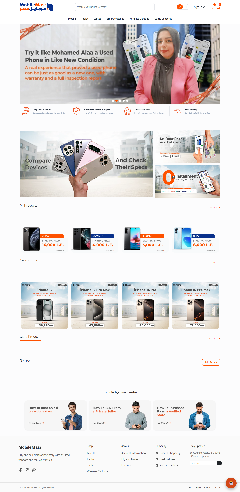
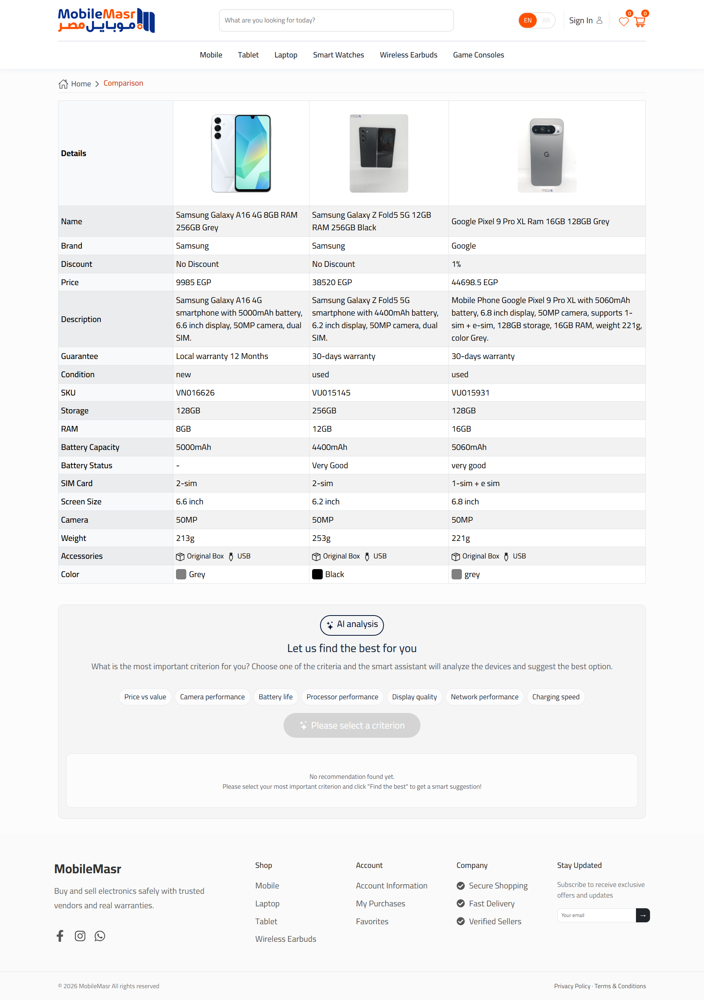
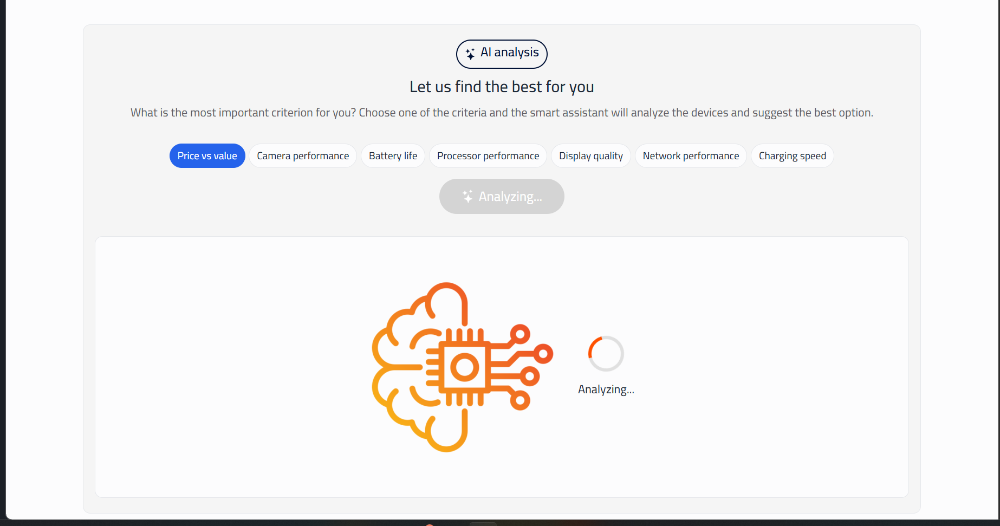
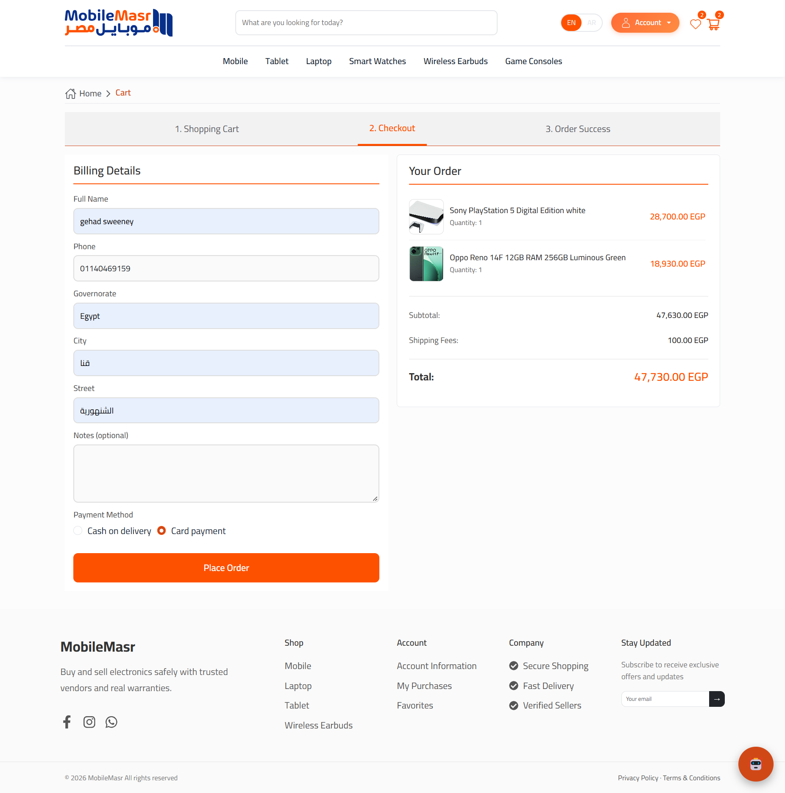
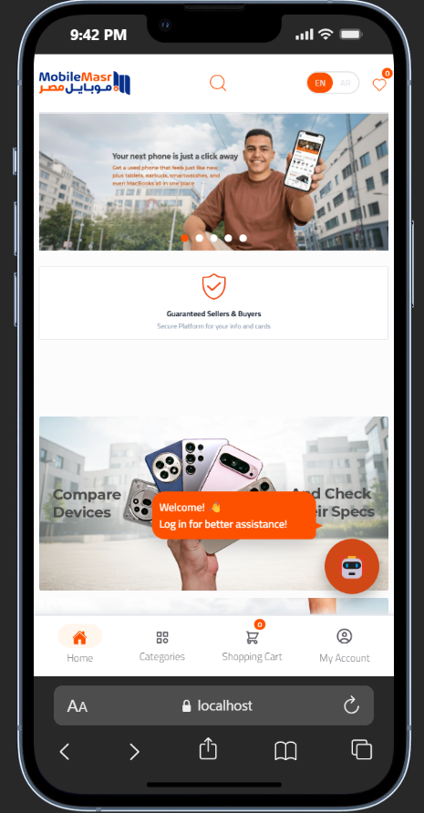
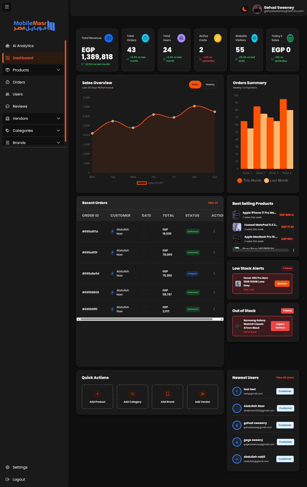
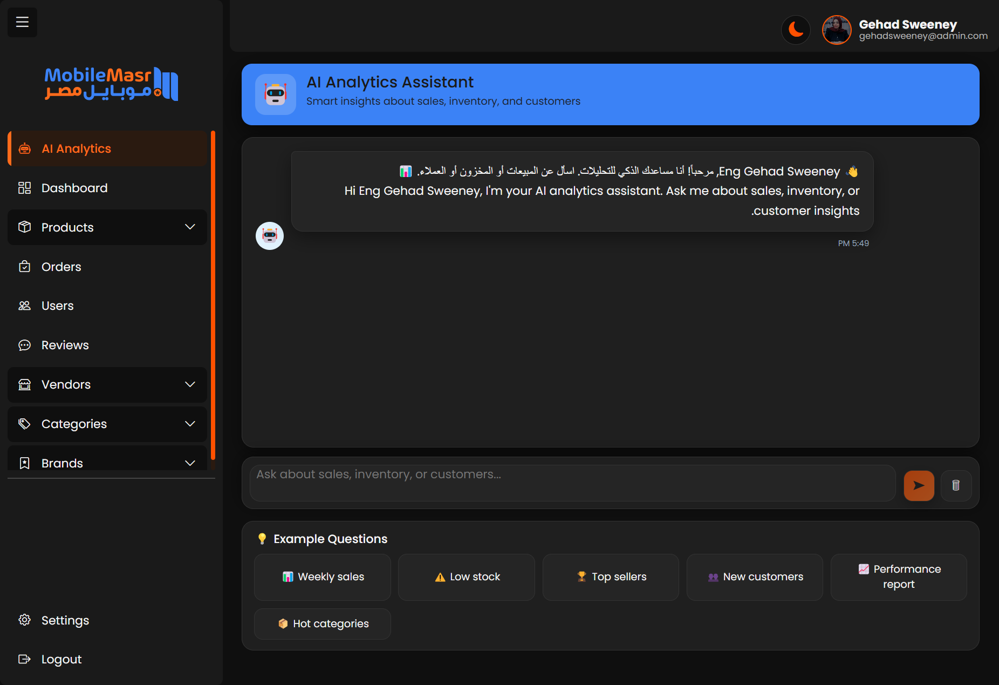
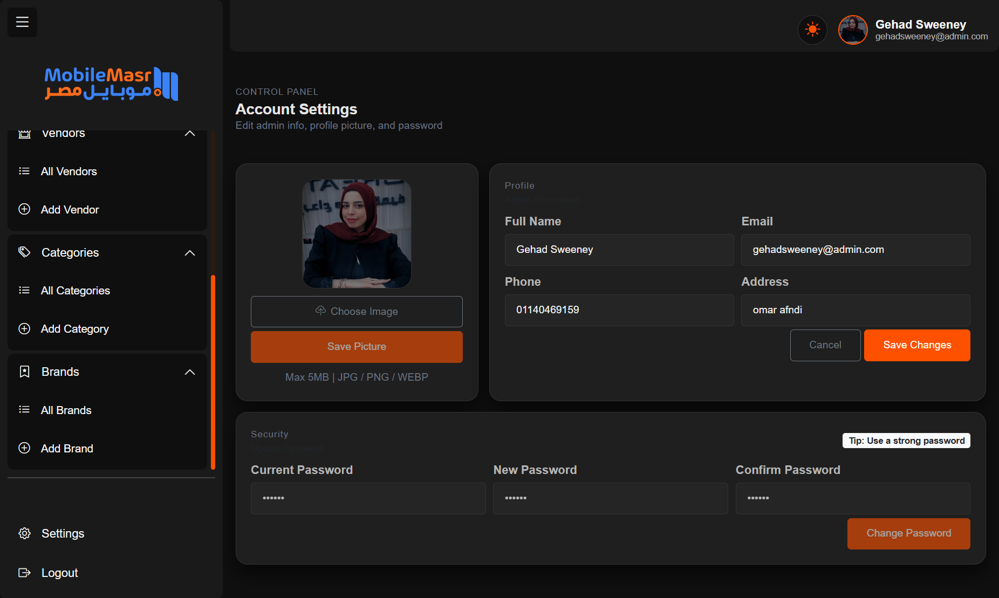
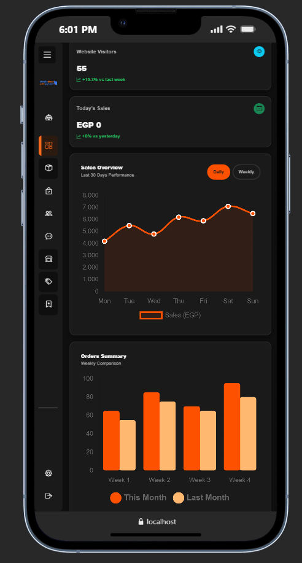

<div align="center">

# 📱 Mobile Masr

**A full-stack AI-powered e-commerce platform for phones, tablets, laptops & accessories**

[](https://react.dev)
[](https://angular.dev)
[](https://nodejs.org)
[](https://expressjs.com)
[](https://mongodb.com)
[](https://openai.com)
[](https://stripe.com)
[](https://cloudinary.com)

</div>

---

## 📌 Overview

**Mobile Masr** is a production-grade, three-tier e-commerce application targeting the Egyptian electronics market. It covers the full shopping lifecycle — from browsing and AI-assisted search, to cart management, Stripe-powered checkout, and post-purchase order tracking — while giving store admins a dedicated Angular dashboard with live analytics and its own AI assistant.

The platform is built as a monorepo with three independent apps that share a single REST API backend:

| App | Tech | Role |
|-----|------|------|
| `client/` | React 19 + Vite | Customer-facing storefront |
| `admin-dashboard/` | Angular 20 | Store management panel |
| `server/` | Node.js + Express 5 + MongoDB | Shared REST API + AI engine |

---

## 👥 Team Members

| Name |
|------|
| Abdullah |
| Mostafa |
| Ghehad |
| Rehab |
| Heba |

---

## 🏗️ Architecture

```
Mobile-Masr-Clone/
├── client/              # React 19 storefront (Vite, Redux Toolkit, i18next)
├── admin-dashboard/     # Angular 20 admin panel (Chart.js, ng2-charts)
└── server/              # Express 5 API (MongoDB, Stripe, Cloudinary, OpenAI)
```

```
Browser (Client)  ──────────────────────────────┐
                                                 │  REST API (JWT)
Browser (Admin)   ──────────────────────────────►  Express 5 + MongoDB
                                                 │
                                           ┌─────┴──────────────────────┐
                                           │  Third-party Integrations  │
                                           │  • OpenAI  (GPT-4o-mini)   │
                                           │  • Stripe  (Payments)      │
                                           │  • Cloudinary (Images)     │
                                           │  • Google OAuth            │
                                           └────────────────────────────┘
```

---

## ✨ Core Features

### 🛍️ Storefront (Client)
- Browse products across 6 categories: Mobiles, Tablets, Laptops, Smart Watches, Wireless Earbuds, Game Consoles
- Product details with images, full specs (RAM, storage, processor, camera, battery, screen size), and vendor info
- Add to cart or wishlist from any product card or details page
- Cart management with quantity controls
- Full checkout flow with shipping address and Stripe card payment
- Order confirmation and success screen
- Vendor profile pages with their product listings
- User profile with order history, saved addresses, favorites, and account settings
- Google OAuth sign-in alongside standard email/password auth

### 📊 Admin Dashboard
- Live KPI cards: revenue, orders, users, site visits
- Sales line chart (daily / weekly toggle) and orders bar chart (month vs. previous month)
- Best-selling products panel with real images from API
- Low stock and out-of-stock alerts with quick-access links
- Full CRUD for products, categories, brands, vendors
- Orders listing and full order detail view
- Users management
- Reviews moderation (view + delete)
- Admin profile settings with avatar upload and password change
- Route-level protection via `adminGuard` — non-admins are redirected

### 🌍 Multi-Language
- Full **Arabic / English** support across the storefront via `i18next`
- RTL layout auto-applied when Arabic is active
- Language preference persisted in `localStorage`

### 📦 Image Management
- All product and profile images stored on **Cloudinary** via Multer middleware
- Image upload handled server-side, CDN URLs returned to the client

---

## 🤖 AI Features

The platform has four distinct AI capabilities, all powered by **OpenAI GPT-4o-mini**. Three are used on the storefront and one is exclusive to the admin dashboard.

---

### 1. 🔍 AI-Powered Product Search *(Client)*

A natural-language search engine that understands Arabic, English, Arabizi, and typos — and maps the user's intent to the correct category, brand, and product query before searching.

**How it works:**
The user's query is sent directly to GPT-4o-mini (from the browser) with a structured system prompt. The model returns a JSON object containing:
- `intent`: product / brand / category / mixed
- `categorySlug`: one of `mobile`, `tablet`, `laptop`, `smart-watches`, `wireless-earbuds`, `game-consoles`, `all`
- `brand`: canonical English brand name (e.g. `Apple`, `Samsung`) or `null`
- `normalizedQuery`: clean English/Latin search string (no Arabic)
- `confidence`: 0–100

The frontend then applies a three-stage filter (category → brand → token matching) against the product list, with automatic fallback to plain text search if the AI returns no results.

| User types | AI resolves to |
|-----------|----------------|
| `موبايلات سامسونج` | category: mobile, brand: Samsung |
| `ايفون ١٥ برو ماكس` | category: mobile, brand: Apple, query: `iphone 15 pro max` |
| `labtop hp` | category: laptop, brand: HP |
| `سماعات بلوتوث` | category: wireless-earbuds |
| `بلايستيشن` | category: game-consoles |

Live suggestions appear as the user types (no AI call — pure client-side token matching).

---

### 2. ⚖️ AI Product Comparison *(Client)*

On the Comparison page, after the user adds 2 or more products, an AI section appears below the comparison table.

**How it works:**
The user picks one criterion from a category-aware list. The full product objects and criterion are sent to GPT-4o-mini, which:
- Scores each product 0–100 using **80% selected criterion + 20% price-value efficiency**
- Returns structured JSON with per-product scores, two key spec details per product, and a short reason
- Highlights the single best product with a final recommendation summary
- Uses its own general knowledge about well-known device models to fill any missing specs

Criteria change dynamically based on what is being compared (e.g. Mobiles: Camera, Battery, Performance, Storage; Laptops: Performance, Display, Battery, Storage).

---

### 3. 💬 AI Chat Assistant *(Client)*

A floating 🤖 chat button available on every page of the storefront, giving users a persistent AI shopping assistant throughout their session.

**How it works (backend RAG pipeline):**
1. The user's message is sent to the backend (`POST /ai` with `feature: "chat"`)
2. The server runs a **Hybrid RAG** pipeline:
   - Fetches up to 50 products from MongoDB
   - Generates an OpenAI text embedding (`text-embedding-3-small`) for each product and for the user's question
   - Computes cosine similarity and selects the top-5 most relevant products
3. The top-5 product context + the last 6 messages of conversation history + the user's profile data (order count, cart, categories) are injected into the GPT-4o-mini system prompt
4. The response includes an `answer` text and up to 3 `productsSuggested` objects rendered as inline product cards (image, name, price, "View Details" link)

**Chat features:**
- Persists per-user session in `sessionStorage` (keyed by user ID)
- Responds in the same language the user writes in (Arabic or English)
- Personalized greeting using the logged-in user's first name
- Unread message indicator (red dot on the floating button)
- Typing indicator while waiting for response
- `Ctrl + Enter` to send

---

### 4. 🧠 AI Admin Analytics Assistant *(Admin Dashboard)*

An AI assistant exclusive to the admin panel, accessible at `/admin/ai-chat`.

**How it works:**
The admin's question hits `POST /admin/ai-chat` (protected — admins only). The server:
1. Runs MongoDB aggregations to compute real-time business data:
   - Revenue and order counts for the last 30 days
   - Top 5 best-selling products
   - New customers this month
   - Low-stock alerts (< 5 items)
2. Computes profit summaries for **today / this month / this year**, broken down by new vs. used products, with per-admin share (5 admins total)
3. Injects all figures as authoritative context into the GPT-4o-mini prompt so the model never fabricates numbers

**What the admin can ask:**
- Weekly or monthly sales totals
- Best-selling products and top-profit items
- Low stock alerts
- New customer acquisition
- Full performance report with profit breakdown

Response data also includes structured `charts` (bar + pie JSON) and `productCards` payloads for the frontend to render visually.

---

## 🖼️ Screenshots

### Client — Desktop

<table>
  <tr>
    <td align="center"><strong>Home — English</strong></td>
    <td align="center"><strong>Home — Arabic (RTL)</strong></td>
  </tr>
  <tr>
    <td></td>
    <td></td>
  </tr>
  <tr>
    <td align="center"><strong>Product Listing</strong></td>
    <td align="center"><strong>Product Details</strong></td>
  </tr>
  <tr>
    <td></td>
    <td></td>
  </tr>
  <tr>
    <td align="center"><strong>AI Comparison</strong></td>
    <td align="center"><strong>AI Recommendation Result</strong></td>
  </tr>
  <tr>
    <td></td>
    <td></td>
  </tr>
  <tr>
    <td align="center"><strong>Ask AI to Compare</strong></td>
    <td align="center"><strong>Cart</strong></td>
  </tr>
  <tr>
    <td></td>
    <td></td>
  </tr>
  <tr>
    <td align="center"><strong>Checkout</strong></td>
    <td align="center"><strong>Order Success</strong></td>
  </tr>
  <tr>
    <td></td>
    <td></td>
  </tr>
  <tr>
    <td align="center"><strong>Favorites</strong></td>
    <td align="center"><strong>User Settings</strong></td>
  </tr>
  <tr>
    <td></td>
    <td></td>
  </tr>
</table>

---

### Client — Mobile

<table>
  <tr>
    <td align="center"><strong>Welcome</strong></td>
    <td align="center"><strong>Login</strong></td>
    <td align="center"><strong>AI Chat</strong></td>
  </tr>
  <tr>
    <td></td>
    <td></td>
    <td></td>
  </tr>
  <tr>
    <td align="center"><strong>Cart</strong></td>
    <td align="center"><strong>My Account</strong></td>
    <td align="center"><strong>Categories</strong></td>
  </tr>
  <tr>
    <td></td>
    <td></td>
    <td></td>
  </tr>
</table>

---

### Admin Dashboard

<table>
  <tr>
    <td align="center"><strong>Login</strong></td>
    <td align="center"><strong>Dashboard</strong></td>
  </tr>
  <tr>
    <td></td>
    <td></td>
  </tr>
  <tr>
    <td align="center"><strong>All Products</strong></td>
    <td align="center"><strong>Orders</strong></td>
  </tr>
  <tr>
    <td></td>
    <td></td>
  </tr>
  <tr>
    <td align="center"><strong>AI Admin Assistant</strong></td>
    <td align="center"><strong>Reviews</strong></td>
  </tr>
  <tr>
    <td></td>
    <td></td>
  </tr>
  <tr>
    <td align="center"><strong>Settings</strong></td>
    <td align="center"><strong>Dashboard — Mobile</strong></td>
  </tr>
  <tr>
    <td></td>
    <td></td>
  </tr>
</table>

---

## 🛠️ Tech Stack

### Client
| Category | Technology |
|----------|------------|
| Framework | React 19 |
| Build Tool | Vite 7 |
| State Management | Redux Toolkit 2 |
| Routing | React Router DOM 7 |
| UI | Bootstrap 5.3 + React Bootstrap |
| Forms | React Hook Form + Yup |
| Localization | i18next (AR / EN) |
| HTTP | Axios |
| Auth | JWT + Google OAuth (`@react-oauth/google`) |
| AI (Search & Compare) | OpenAI GPT-4o-mini (direct browser call) |
| Notifications | React Toastify |
| Carousel | Swiper 12 |

### Admin Dashboard
| Category | Technology |
|----------|------------|
| Framework | Angular 20 (Standalone Components) |
| Language | TypeScript 5.9 |
| UI | Bootstrap 5.3 |
| Charts | Chart.js 4 + ng2-charts 7 |
| Forms | Reactive Forms |
| Notifications | ngx-toastr |
| HTTP | Angular HttpClient |

### Server
| Category | Technology |
|----------|------------|
| Runtime | Node.js |
| Framework | Express 5 |
| Database | MongoDB + Mongoose 8 |
| Authentication | JWT (`jsonwebtoken`) + bcryptjs |
| Google Auth | `google-auth-library` |
| Payments | Stripe 20 (Checkout Sessions + Webhooks) |
| Image Storage | Cloudinary + Multer |
| AI Engine | OpenAI SDK (`gpt-4o-mini`, `text-embedding-3-small`) |
| Validation | express-validator |
| API Docs | Swagger UI (OpenAPI 3.0) |

---

## 📡 API Overview

The server exposes the following route groups, all prefixed from `/`:

| Route | Description | Auth |
|-------|-------------|------|
| `GET /` | Health check | Public |
| `POST /auth/*` | Register, Login, Google OAuth, password reset | Public / JWT |
| `GET /products` | Product listing with filters & pagination | Public |
| `GET /products/:id` | Single product details | Public |
| `GET /categories` | All categories | Public |
| `GET /brands` | All brands | Public |
| `GET /vendors/:id` | Vendor profile | Public |
| `GET/POST /cart` | Cart management | JWT |
| `GET/POST /orders` | Order creation and history | JWT |
| `POST /stripe/checkout` | Create Stripe Checkout session | JWT |
| `GET /stripe/verify` | Verify payment and create order | JWT |
| `POST /stripe/webhook` | Stripe webhook handler | Stripe-Signature |
| `GET/POST /wishlist` | Wishlist management | JWT |
| `GET/POST /reviews` | Site reviews | JWT |
| `POST /ai` | AI chat, comparison, and recommendation | Public / JWT |
| `POST /admin/ai-chat` | AI analytics assistant for admins | JWT + Admin |
| `GET /admin/users` | User management | JWT + Admin |
| `GET /dashboard` | Dashboard overview stats and charts | JWT + Admin |
| `POST /track` | Track site visits | Public |
| `GET /api-docs` | Swagger UI documentation | Public |

### Authentication
- All protected routes require `Authorization: Bearer <token>` header
- Token is a signed JWT (`jsonwebtoken`) containing `{ id, role }`
- `protect` middleware verifies the token and attaches `req.user`
- `admin` middleware checks `req.user.role === "admin"` and returns 403 otherwise
- Google OAuth tokens are verified via `google-auth-library` before a site JWT is issued

### Stripe Payment Flow
```
Client                     Server                        Stripe
  │                           │                             │
  │── POST /stripe/checkout ──►│── create session ──────────►│
  │◄── { url, sessionId } ────│◄── session object ──────────│
  │                           │                             │
  │── redirect to Stripe ────────────────────────────────────►│
  │◄─────────── redirect to /cart/order-success ─────────────│
  │                           │                             │
  │── GET /stripe/verify ─────►│── retrieve session ─────────►│
  │                           │◄── payment_status: paid ────│
  │                           │                             │
  │                           │── deduct stock ─────────────│
  │                           │── create Order document ────│
  │                           │── clear cart ───────────────│
  │◄── { order } ─────────────│                             │
```
- Currency: **EGP**
- Fixed shipping fee: **100 EGP** added as a separate line item
- Stock is deducted atomically with rollback on failure
- Webhook handler processes `checkout.session.completed` events

---

## 🗄️ Database Models

| Model | Key Fields |
|-------|-----------|
| `User` | name, email, password (bcrypt), googleId, role (customer/admin), profilePicture, phone, address |
| `Product` | name {en,ar}, price, discount, skuCode, condition, stock, sale, specs (RAM, storage, processor, GPU, camera, battery, screen), images, category, brand, vendor |
| `Category` | name, slug, image |
| `Brand` | name, logo |
| `Vendor` | name, description, logo, contact |
| `Order` | user, items[], shippingAddress, paymentMethod, paymentStatus, orderStatus, subtotal, shippingFees, totalAmount |
| `Cart` | user, items[{product, quantity, price}], totalPrice |
| `Wishlist` | user, products[] |
| `SiteReview` | user, rating, comment |
| `Visit` | timestamp, page |

---

## ⚙️ Local Setup

### Prerequisites
- Node.js v18 or newer
- MongoDB Atlas account (or local `mongod`)
- API keys for: OpenAI, Stripe, Cloudinary, Google OAuth

---

### 1. Clone the repository

```bash
git clone https://github.com/your-org/Mobile-Masr-Clone.git
cd Mobile-Masr-Clone
```

---

### 2. Server setup

```bash
cd server
npm install
```

Copy the example env file and fill in your values:

```bash
cp .env.example .env
```

Required variables:

```env
PORT=3000
DATABASE_URL=mongodb+srv://<user>:<pass>@cluster.mongodb.net/mobilemasr
JWT_SECRET=your_jwt_secret

# Google OAuth
GOOGLE_CLIENT_ID=your_google_client_id

# Cloudinary
CLOUDINARY_CLOUD_NAME=your_cloud_name
CLOUDINARY_API_KEY=your_api_key
CLOUDINARY_API_SECRET=your_api_secret

# Stripe
STRIPE_SECRET_KEY=sk_test_...
STRIPE_WEBHOOK_SECRET=whsec_...
FRONTEND_URL=http://localhost:5173

# OpenAI
OPENAI_API_KEY=sk-...

# Swagger
swaggerURL=http://localhost:3000
```

Start the server:

```bash
npm run dev       # development (nodemon)
npm start         # production
```

API will be available at `http://localhost:3000`  
Swagger docs at `http://localhost:3000/api-docs`

---

### 3. Client setup

```bash
cd client
npm install
```

Create `.env`:

```env
VITE_API_URL=http://localhost:3000
VITE_OPENAI_API_KEY=sk-...
VITE_OPENAI_API_URL=https://api.openai.com/v1/chat/completions
```

> ⚠️ `VITE_OPENAI_API_KEY` is used directly from the browser for AI Search and AI Comparison. Restrict this key to your domain in production.

Start the dev server:

```bash
npm run dev
```

Storefront at `http://localhost:5173`

---

### 4. Admin Dashboard setup

```bash
cd admin-dashboard
npm install
```

Create `.env`:

```env
NG_APP_API_URL=http://localhost:3000
```

Start the dev server:

```bash
npm start
```

Dashboard at `http://localhost:4200`

---

## 📁 Repository Structure

```
Mobile-Masr-Clone/
│
├── client/                         # React 19 storefront
│   ├── src/
│   │   ├── Pages/                  # Route-level page components
│   │   ├── components/             # Shared UI components
│   │   │   ├── ChatFeature/        # Floating AI chat assistant
│   │   │   └── ComparisonComponents/ # AI product comparison
│   │   ├── context/                # AiContext, CompareContext, IsLoginContext
│   │   ├── store/slices/           # Redux slices
│   │   ├── services/               # API clients + AI search service
│   │   └── routes.jsx              # App router
│   └── package.json
│
├── admin-dashboard/                # Angular 20 admin panel
│   ├── src/app/
│   │   ├── Components/             # Feature components (Products, Orders…)
│   │   ├── Services/               # Angular services + AdminAIService
│   │   ├── Models/                 # TypeScript interfaces
│   │   ├── guards/                 # adminGuard
│   │   └── app.routes.ts           # Route definitions
│   └── package.json
│
├── server/                         # Express 5 backend
│   ├── controllers/                # Route handlers
│   ├── features/                   # AI feature modules (chat, compare, admin…)
│   ├── middleware/                  # JWT auth, Multer upload, visit tracking
│   ├── models/                     # Mongoose schemas
│   ├── routes/                     # Express routers
│   ├── services/                   # AI service + Hybrid RAG service
│   ├── config/                     # DB connection, Cloudinary, Stripe client
│   ├── utils/                      # OpenAI client wrapper
│   └── app.js                      # App entry point
│
├── screenshots/                    # Project screenshots
└── README.md                       # This file
```

---

## 🔐 Security Notes

- Never commit `.env` files — they are in `.gitignore`
- The `VITE_OPENAI_API_KEY` is exposed in the browser bundle; restrict it to your domain via OpenAI's API key settings in production
- All admin routes on the backend require both a valid JWT **and** `role: "admin"`
- Stripe webhook signatures are verified before any order processing

---

## 📖 API Documentation

Interactive Swagger docs are available at:

```
http://localhost:3000/api-docs
```

All endpoints are documented with request/response schemas and JWT security requirements.
