<div align="center">


# Mobile Masr — Admin Dashboard

**A professional control panel for managing Egypt's largest mobile e-commerce store**

[](https://angular.dev)
[](https://www.typescriptlang.org)
[](https://getbootstrap.com)
[](https://www.chartjs.org)
[](https://rxjs.dev)
[](https://www.npmjs.com/package/ngx-toastr)

</div>

---

## 📌 Overview

**Mobile Masr Admin Dashboard** is the central control panel for a mobile phones and accessories e-commerce platform. It gives administrators a single place to manage every aspect of the store — from products, orders, and users, to an AI-powered assistant that answers data questions in real time.

Built entirely with **Angular 20**, the dashboard communicates with the backend via a JWT-protected REST API, with full route protection enforced through an admin route guard.

---

## 👥 Team Members

| Name |
|------|
| Abdullah |
| Mostafa |
| Ghehad |
| Rehab |
| Heba |

---

## ✨ Key Features

### 🔐 Authentication & Route Protection
- Dedicated login page for admin access only
- All `/admin` routes protected by `adminGuard`
- Token stored in `localStorage` and sent automatically with every API request
- Instant redirect with a toast notification on unauthorized access attempts

### 📊 Analytics Dashboard
- Live KPI cards: total revenue, orders, users, and site visits
- **Sales Line Chart** with a daily/weekly filter that updates the chart instantly
- **Orders Bar Chart** comparing the current month vs. the previous month
- Recent orders table with direct actions (view, delete)
- Best-selling products panel with real images and API data
- Low stock and out-of-stock alerts with quick-access links
- Confirmation popup before destructive actions

### 🛍️ Product Management
- Full product listing with **Pagination** and real-time **Search**
- Unified Add/Edit product form
- Dedicated product details page
- Delete with confirmation popup
- Image upload via a dedicated Upload service

### 📦 Order Management
- Complete orders list
- Full order details page

### 👤 User Management
- View all registered users and their account data

### 🏪 Vendor Management
- Add, edit, and view vendor records

### 🏷️ Categories & Brands
- Add, edit, and view categories and brands

### ⭐ Reviews Moderation
- View all customer reviews
- Delete inappropriate reviews with a confirmation popup

### ⚙️ Admin Settings
- Edit profile info (name, email, phone, address)
- Upload a profile picture (up to 5MB) with instant preview
- Change password with match validation
- Reactive Forms with full Validators

---

## 🤖 AI Analytics Assistant

One of the standout features of this dashboard is a built-in AI assistant that communicates directly with the backend to answer the admin's questions in natural language.

### How it works
The assistant sends the admin's question to a dedicated endpoint (`/admin/ai-chat`) powered by AI on the backend side. The response comes back as a structured answer covering profits, top products, and customer insights.

### What the admin can ask

| Example | Description |
|---------|-------------|
| 📊 `What were the total sales last week?` | Weekly sales summary |
| 🏆 `Top 3 products this month?` | Best-selling products |
| ⚠️ `Which products are low on stock?` | Low stock alerts |
| 👥 `How many new customers joined?` | New customer stats |
| 📈 `Give me a performance overview` | Full performance report |
| 📦 `Which categories are performing best?` | Category performance |

### Additional chat features
- **Persistent history** — conversation is saved in `localStorage` and survives page reloads
- **Arabic & English support** — text direction (`dir`) is set automatically based on the response language
- **Dynamic welcome message** — displays the admin's real name fetched from the API
- **Typing indicator** — shown while waiting for the AI response
- **Bullet point formatting** — long answers are automatically broken into structured lists
- **Quick-action buttons** — 6 shortcut buttons for the most common questions
- **Clear chat** — 🗑 button to start a fresh conversation
- **Keyboard shortcut** — `Enter` to send, `Shift+Enter` for a new line

---

## 🖼️ Screenshots

### 🖥️ Desktop Views

<table>
  <tr>
    <td align="center"><strong>Login</strong></td>
    <td align="center"><strong>Dashboard</strong></td>
  </tr>
  <tr>
    <td>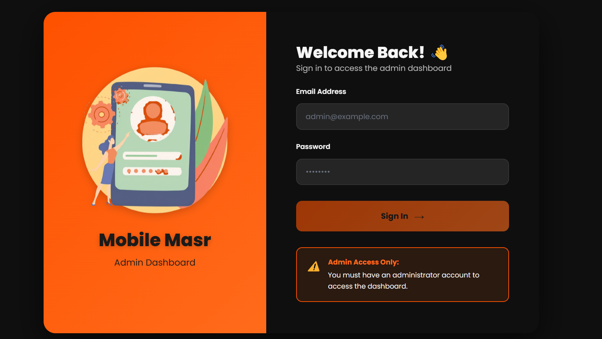</td>
    <td></td>
  </tr>
  <tr>
    <td align="center"><strong>All Products</strong></td>
    <td align="center"><strong>Add Product</strong></td>
  </tr>
  <tr>
    <td>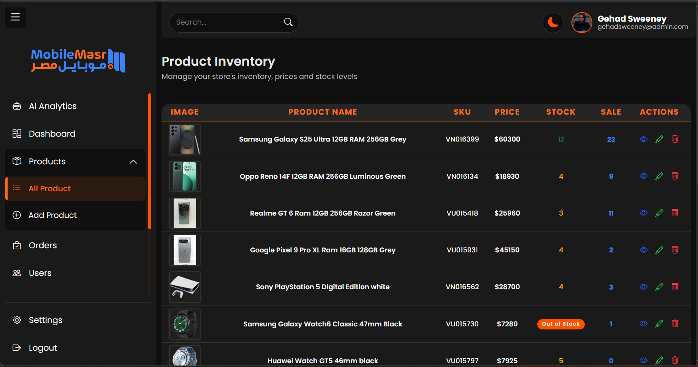</td>
    <td>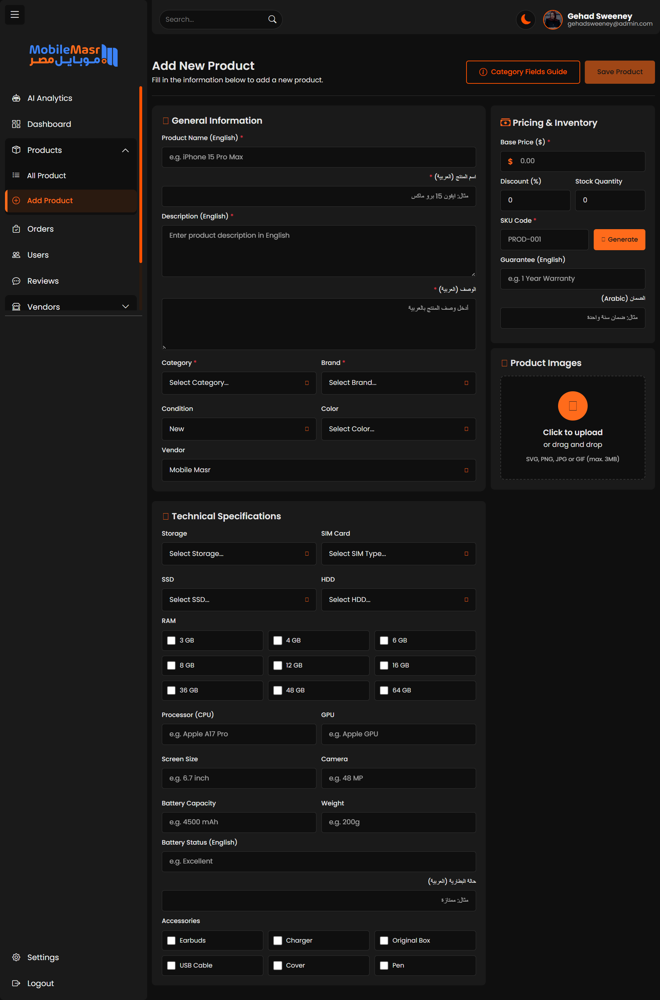</td>
  </tr>
  <tr>
    <td align="center"><strong>Orders</strong></td>
    <td align="center"><strong>All Users</strong></td>
  </tr>
  <tr>
    <td>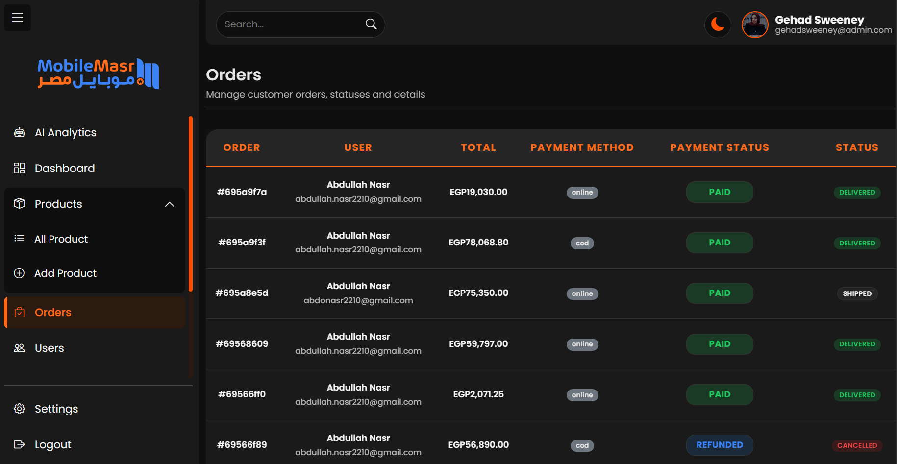</td>
    <td>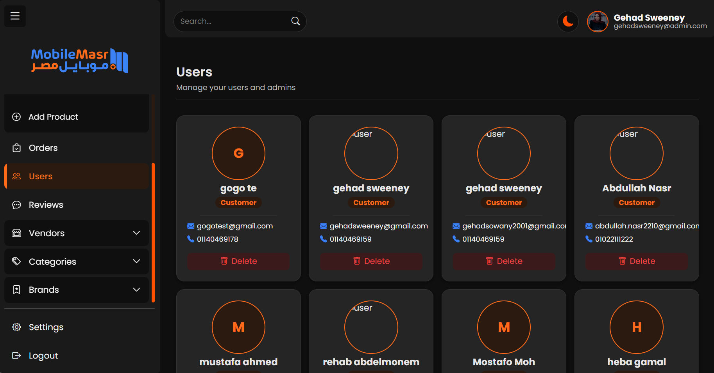</td>
  </tr>
  <tr>
    <td align="center"><strong>All Vendors</strong></td>
    <td align="center"><strong>Add Vendor</strong></td>
  </tr>
  <tr>
    <td>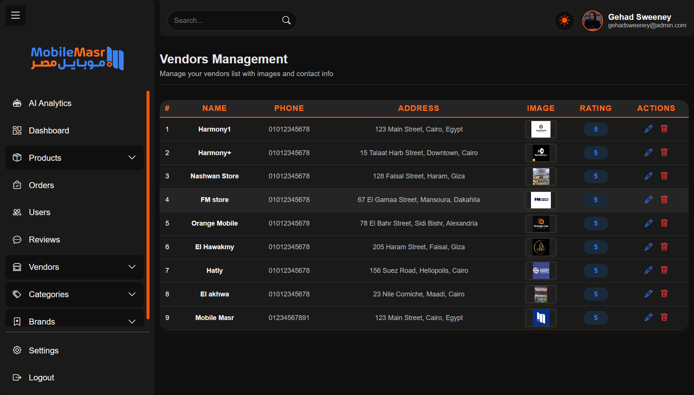</td>
    <td>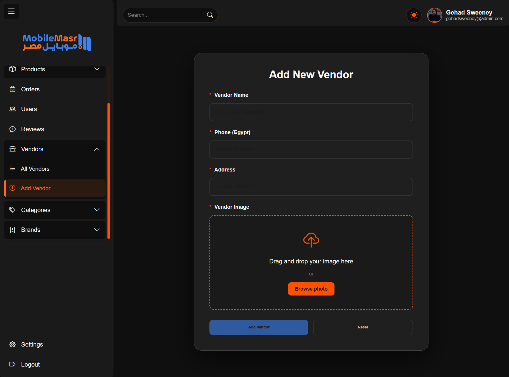</td>
  </tr>
  <tr>
    <td align="center"><strong>All Categories</strong></td>
    <td align="center"><strong>Add Category</strong></td>
  </tr>
  <tr>
    <td>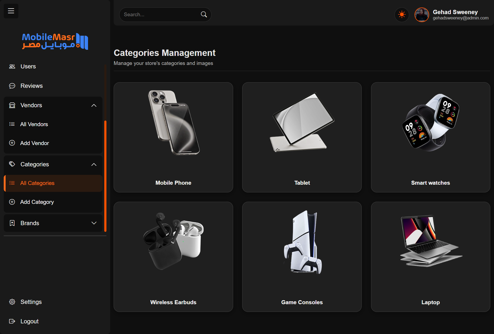</td>
    <td>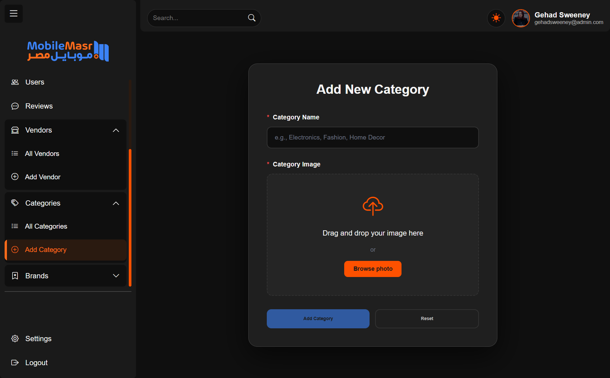</td>
  </tr>
  <tr>
    <td align="center"><strong>All Brands</strong></td>
    <td align="center"><strong>Add Brand</strong></td>
  </tr>
  <tr>
    <td>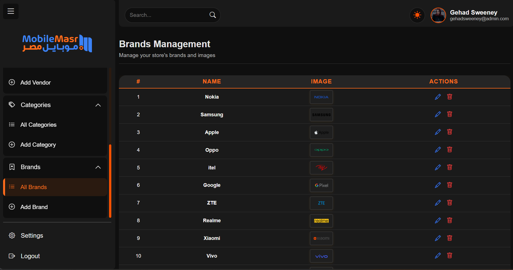</td>
    <td>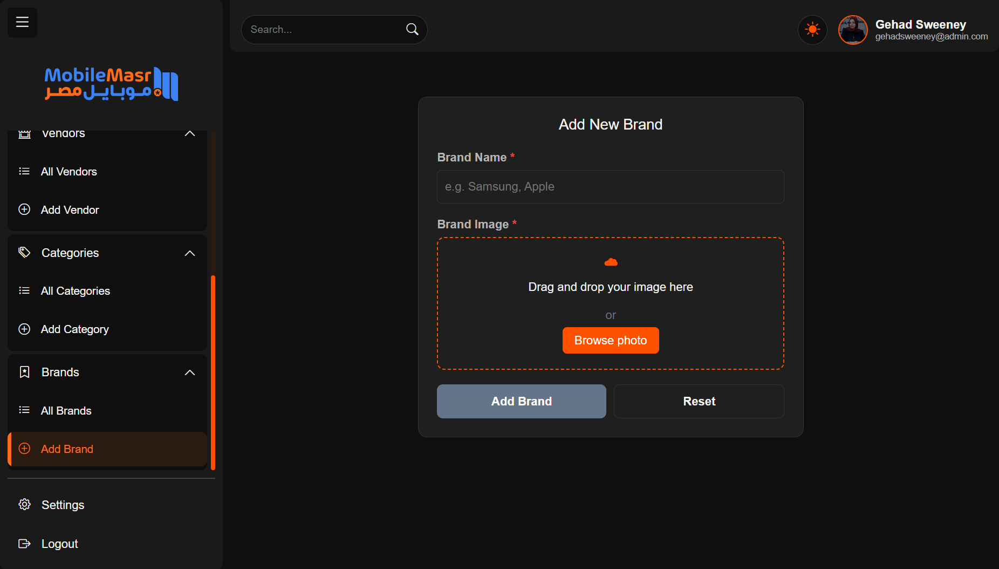</td>
  </tr>
  <tr>
    <td align="center"><strong>Reviews</strong></td>
    <td align="center"><strong>Settings</strong></td>
  </tr>
  <tr>
    <td>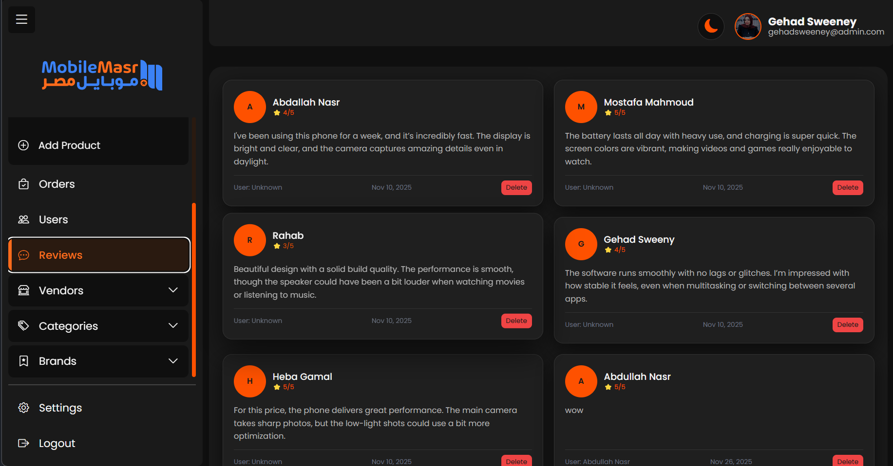</td>
    <td></td>
  </tr>
  <tr>
    <td align="center" colspan="2"><strong>AI Analytics Assistant</strong></td>
  </tr>
  <tr>
    <td colspan="2" align="center"></td>
  </tr>
</table>

---

### 📱 Mobile Views

<table>
  <tr>
    <td align="center"><strong>Dashboard</strong></td>
    <td align="center"><strong>Add Product</strong></td>
    <td align="center"><strong>All Brands</strong></td>
  </tr>
  <tr>
    <td></td>
    <td>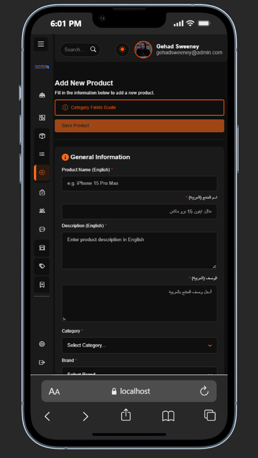</td>
    <td>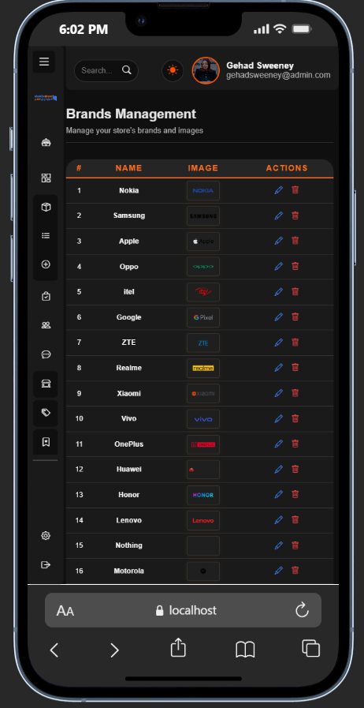</td>
  </tr>
  <tr>
    <td align="center"><strong>AI Assistant</strong></td>
    <td align="center"><strong>Settings</strong></td>
    <td align="center"></td>
  </tr>
  <tr>
    <td>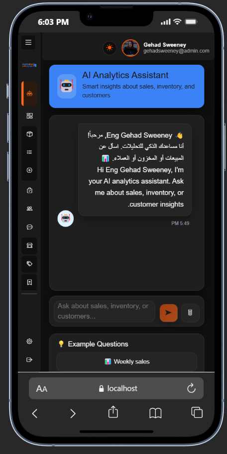</td>
    <td>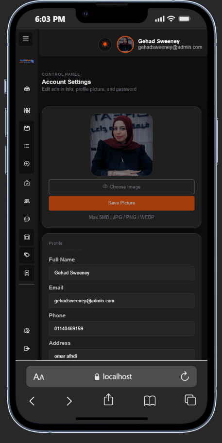</td>
    <td></td>
  </tr>
</table>

---

## 🛠️ Tech Stack

| Category | Technology |
|----------|------------|
| Framework | Angular 20 (Standalone Components) |
| Language | TypeScript 5.9 |
| UI | Bootstrap 5.3 |
| Charts | Chart.js 4 + ng2-charts 7 |
| Notifications | ngx-toastr |
| HTTP | Angular HttpClient |
| Forms | Reactive Forms + Template-Driven |
| Routing | Angular Router + adminGuard |
| AI Integration | REST API (`/admin/ai-chat`) |

---

## 🧱 Project Structure

```
admin-dashboard/
├── src/
│   ├── app/
│   │   ├── Components/
│   │   │   ├── DashboardComponents/     # Main dashboard, KPI cards, charts
│   │   │   ├── ProductComponents/       # Product list, add/edit form, details
│   │   │   ├── OrderComponents/         # Orders list and order details
│   │   │   ├── UserComponents/          # User management views
│   │   │   ├── VendorComponents/        # Vendor list and vendor form
│   │   │   ├── CategoryComponents/      # Category management
│   │   │   ├── BrandComponents/         # Brand management
│   │   │   ├── ReviewComponents/        # Reviews moderation
│   │   │   ├── admin-aicomponents/      # AI analytics assistant
│   │   │   ├── admin-settings/          # Admin profile & settings
│   │   │   ├── NavbarComponents/        # Top navigation bar
│   │   │   ├── SidebarComponents/       # Side navigation
│   │   │   ├── layout/                  # Main admin shell
│   │   │   ├── login/                   # Login page
│   │   │   ├── loader/                  # Loading state component
│   │   │   └── not-found/               # 404 page
│   │   ├── Services/                    # API service layer
│   │   ├── Models/                      # TypeScript interfaces
│   │   ├── guards/                      # adminGuard
│   │   ├── app.routes.ts                # Application routes
│   │   └── app.config.ts                # App-wide providers
│   └── environments/
│       ├── environment.ts               # Production config
│       └── environment.development.ts   # Development config
├── public/
│   └── mobilemasr.webp
├── screenshots/
└── package.json
```

---

## 🧭 Application Routes

### Public Routes

| Path | Description |
|------|-------------|
| `/login` | Admin login page |
| `**` | 404 not found page |

### Protected Admin Routes (require `adminGuard`)

| Path | Description |
|------|-------------|
| `/admin/dashboard` | Main analytics overview |
| `/admin/products` | Product listing |
| `/admin/products/add` | Add new product |
| `/admin/products/edit/:id` | Edit product |
| `/admin/products/details/:id` | Product details |
| `/admin/orders` | Orders listing |
| `/admin/orders/:id` | Order details |
| `/admin/users` | User management |
| `/admin/vendors` | Vendor management |
| `/admin/vendors/add` | Add vendor |
| `/admin/vendors/edit/:id` | Edit vendor |
| `/admin/categories` | Category management |
| `/admin/categories/add` | Add category |
| `/admin/brands` | Brand management |
| `/admin/brands/add` | Add brand |
| `/admin/brands/edit/:id` | Edit brand |
| `/admin/reviews` | Reviews moderation |
| `/admin/ai-chat` | AI analytics assistant |
| `/admin/settings` | Admin settings |

---

## ⚙️ Local Setup

### Prerequisites

- Node.js v18 or newer
- The Mobile Masr backend running on `localhost:3000`

### 1. Install dependencies

```bash
npm install
```

### 2. Configure the API URL

Make sure the environment files point to the correct backend:

```ts
// src/environments/environment.development.ts
export const environment = {
  apiUrl: 'http://localhost:3000'
};
```

### 3. Start the development server

```bash
npm start
```

Open your browser at: `http://localhost:4200`

### 4. Build for production

```bash
npm run build
```

### 5. Run tests

```bash
npm test
```

---

## 🔐 Authentication Flow

```
[Admin] → Login Page → POST /auth/login
                          ↓
                  Token stored in localStorage
                          ↓
            Route navigation → adminGuard checks token
                          ↓
          ✅ Admin role  →  Access granted
          ❌ Other role  →  Redirect to /login + Toast
```

---

## 📚 Notes

- This dashboard is designed to work alongside the Mobile Masr client app and backend server.
- All API requests automatically attach the Bearer token from `localStorage`.
- The UI is fully responsive and works on mobile screens.
