<div align="center">


# Mobile Masr — Client

**Egypt's smart e-commerce platform for phones, tablets, laptops & accessories**

[](https://react.dev)
[](https://vite.dev)
[](https://redux-toolkit.js.org)
[](https://getbootstrap.com)
[](https://www.i18next.com)
[](https://openai.com)

</div>

---

## 📌 Overview

**Mobile Masr** is a full-featured React e-commerce storefront specializing in mobile phones, tablets, laptops, smart watches, wireless earbuds, and game consoles. It combines a polished shopping experience with three distinct AI-powered features that help users find, compare, and choose the right products intelligently.

The app is built with **React 19 + Vite**, uses **Redux Toolkit** for global state management, supports **Arabic/English** switching via i18next, and integrates **OpenAI GPT-4o-mini** for all AI capabilities.

---

## 👥 Team Members

| Name |
|------|
| Abdullah |
| Mostafa |
| Ghehad |
| Rehab |
| Heba |

---

## ✨ Key Features

### 🛍️ Shopping Experience
- Browse products by category: Mobile, Tablet, Laptop, Smart Watches, Wireless Earbuds, Game Consoles
- Product details page with images, specs, price, and vendor info
- Add to cart or wishlist directly from any product card
- Cart management: adjust quantities and remove items
- Full checkout flow with order confirmation screen
- Vendor profile pages with their product listings

### 🔐 Authentication
- Register and login with email/password
- Google OAuth sign-in via `@react-oauth/google`
- Protected routes — cart, checkout, profile, and wishlist require login
- Session-aware AI chat that loads the user's chat history on login

### 👤 User Profile
- View and edit account info (name, email, phone)
- Change password
- Manage saved addresses
- View order history and refund requests
- Favorites/wishlist management
- Notifications and ads sections

### 🌍 Multi-Language Support
- Full **Arabic / English** switching via i18next
- RTL layout automatically applied for Arabic
- Language preference persisted in localStorage

---

## 🤖 AI Features

Three distinct AI capabilities are built into the platform, each powered by **OpenAI GPT-4o-mini**.

---

### 1. 🔍 AI-Powered Product Search

A smart search engine that understands natural language, Arabic, Arabizi, and typos — and returns the right products without requiring exact matches.

**How it works:**
The user types a query in the search bar. Before hitting the backend, the query is sent to GPT-4o-mini with a system prompt that instructs the model to:
- Detect the **intent**: product / brand / category / mixed
- Identify the **category slug** (e.g. `mobile`, `laptop`, `smart-watches`)
- Extract the **brand** (e.g. `Apple`, `Samsung`)
- Return a clean **normalized English query** (no Arabic characters) suitable for URL params

The frontend then filters the product list using the AI's output — first by category, then by brand, then by token matching — with a fallback to simple text search if AI returns no results.

**Examples of what it handles:**

| User types | AI understands |
|------------|---------------|
| `موبايلات سامسونج` | `samsung mobile` → category: mobile, brand: Samsung |
| `ايفون ١٥ برو ماكس` | `iphone 15 pro max` → category: mobile, brand: Apple |
| `labtop hp` | `hp laptop` → category: laptop, brand: HP |
| `سماعات بلوتوث` | `wireless earbuds` → category: wireless-earbuds |
| `بلايستيشن` | `game consoles` → category: game-consoles |

- Live suggestions appear as the user types (no AI call needed — pure client-side filtering)
- If AI is unavailable, a local fallback search runs automatically

---

### 2. ⚖️ AI Product Comparison

On the **Comparison page**, after the user adds 2 or more products to compare, an AI section appears at the bottom of the comparison table.

**How it works:**
The user selects one criterion (e.g. Battery Life, Camera, Performance, Price Value) from a dynamically generated list based on the product category. The selected products and criterion are sent to GPT-4o-mini, which:
- Scores each product from 0–100 based on **80% selected criterion + 20% price-value efficiency**
- Returns structured JSON with per-product scores, two key spec details, and a reason
- Highlights the **best product** with a final recommendation summary

**Category-aware criteria** — the criteria list changes depending on what's being compared:
- **Mobiles**: Camera, Battery Life, Performance, Storage, Price Value, Design
- **Laptops**: Performance, Battery Life, Storage, Display, Price Value
- **Smart Watches**: Battery Life, Fitness Tracking, Display, Price Value
- And so on for each category

The AI also uses its own general knowledge about well-known device models to fill in missing specs from the product data.

---

### 3. 💬 AI Chat Assistant

A floating chat button (🤖) available on every page of the site, giving users a persistent AI assistant throughout their browsing session.

**How it works:**
- Messages are sent to the backend endpoint `/ai` with a `feature: "chat"` flag
- The last 6 messages are included as conversation history for context-aware replies
- The AI can suggest relevant products — product cards with image, name, price, and "View Details" link appear inline in the chat
- Chat history is saved to `sessionStorage` per user ID, so it survives page reloads within the same session
- On logout, all chat sessions are cleared

**Features:**
- Floating button with unread message indicator (red dot)
- Welcome bubble showing the logged-in user's first name
- Typing indicator (animated dots) while waiting for response
- Personalized greeting when chat opens (max once per minute)
- Guests see a prompt to log in for better recommendations
- `Ctrl + Enter` keyboard shortcut to send
- Clear chat button to start fresh

---

## 🖼️ Screenshots

### 🖥️ Desktop Views

<table>
  <tr>
    <td align="center"><strong>Home — English</strong></td>
    <td align="center"><strong>Home — Arabic (RTL)</strong></td>
  </tr>
  <tr>
    <td></td>
    <td></td>
  </tr>
  <tr>
    <td align="center"><strong>Product Listing</strong></td>
    <td align="center"><strong>Product Details</strong></td>
  </tr>
  <tr>
    <td>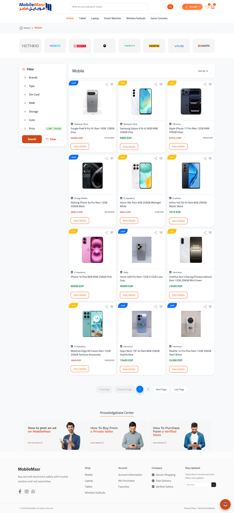</td>
    <td>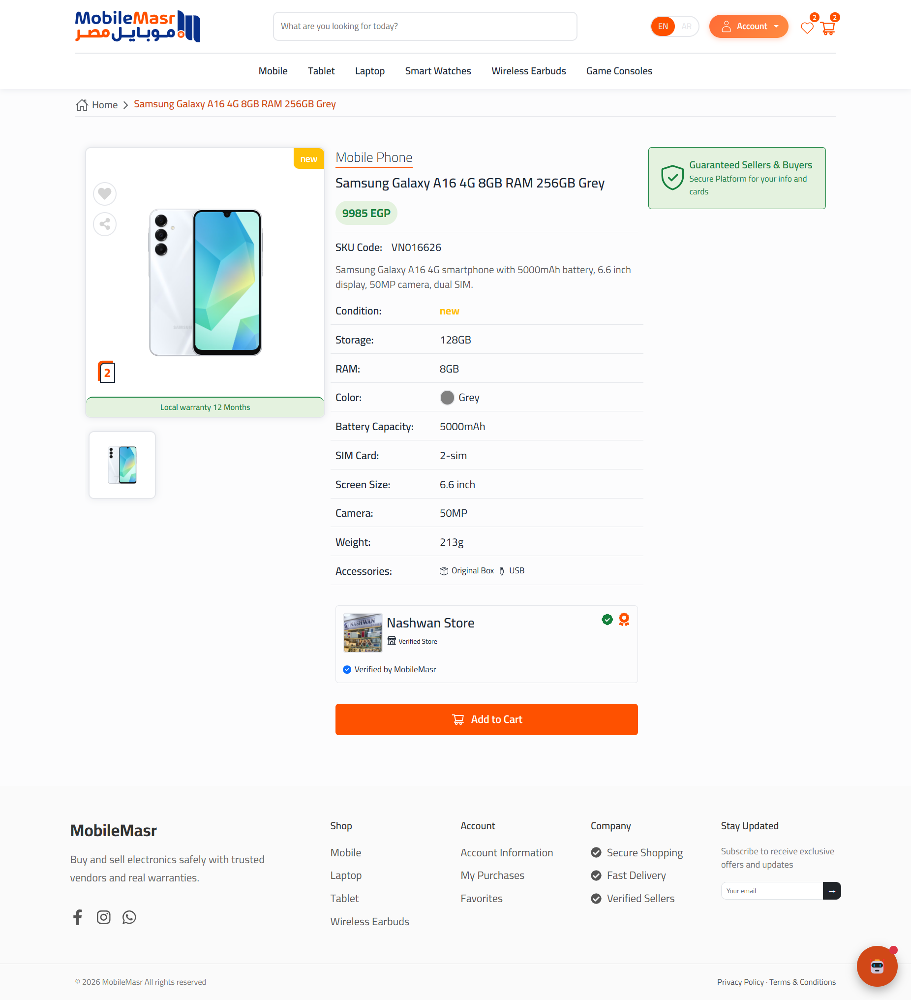</td>
  </tr>
  <tr>
    <td align="center"><strong>AI Search — Ask AI to Compare</strong></td>
    <td align="center"><strong>Comparison Table — Step 1</strong></td>
  </tr>
  <tr>
    <td></td>
    <td>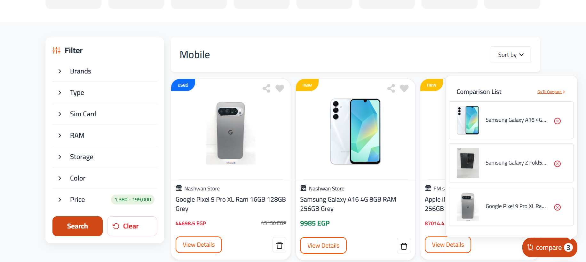</td>
  </tr>
  <tr>
    <td align="center"><strong>Comparison Table — Step 2</strong></td>
    <td align="center"><strong>Cart</strong></td>
  </tr>
  <tr>
    <td></td>
    <td>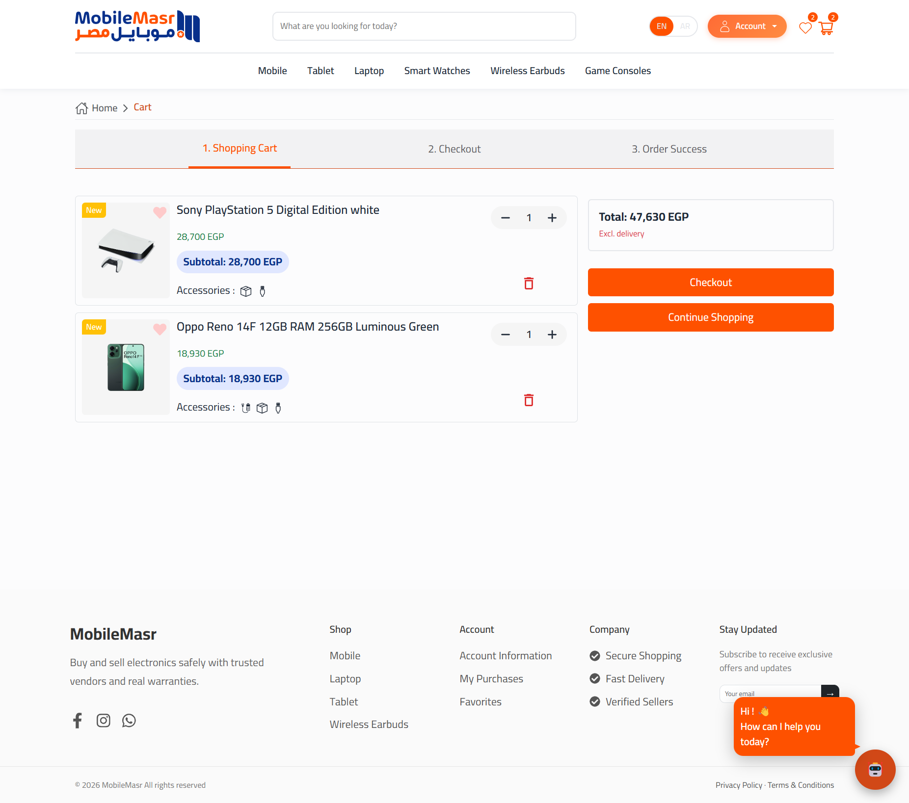</td>
  </tr>
  <tr>
    <td align="center"><strong>Checkout</strong></td>
    <td align="center"><strong>Checkout — Card Payment</strong></td>
  </tr>
  <tr>
    <td></td>
    <td>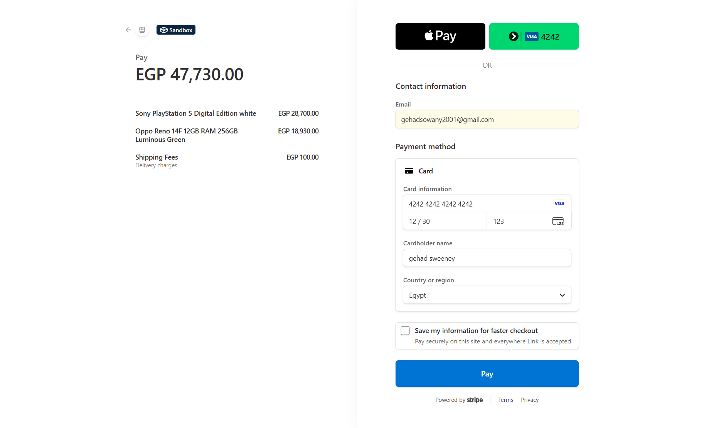</td>
  </tr>
  <tr>
    <td align="center"><strong>Order Success</strong></td>
    <td align="center"><strong>Favorites / Wishlist</strong></td>
  </tr>
  <tr>
    <td>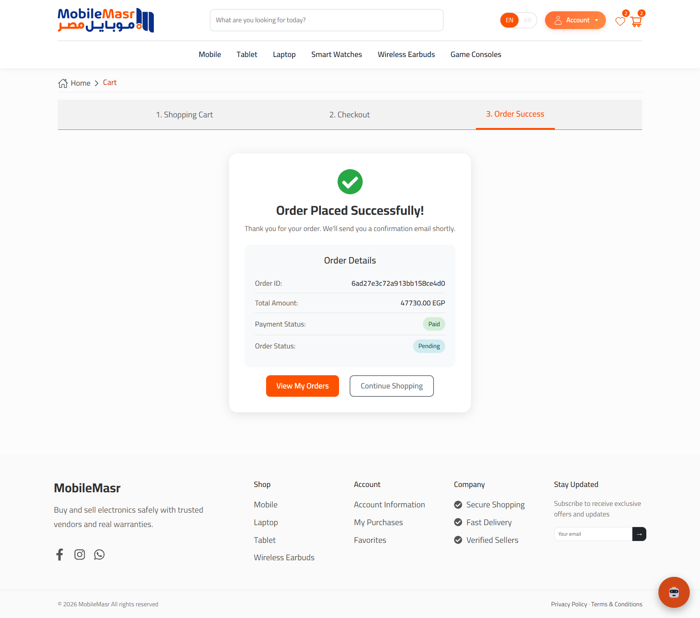</td>
    <td>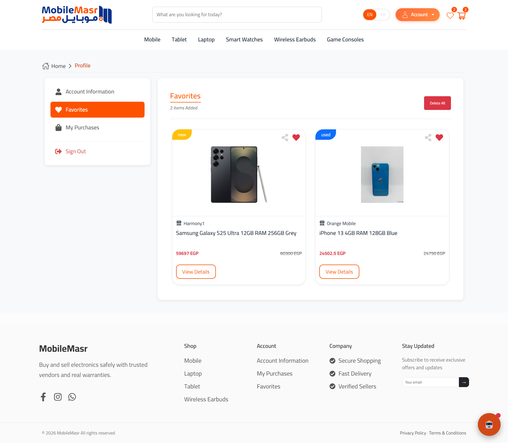</td>
  </tr>
  <tr>
    <td align="center"><strong>Login</strong></td>
    <td align="center"><strong>Register</strong></td>
  </tr>
  <tr>
    <td>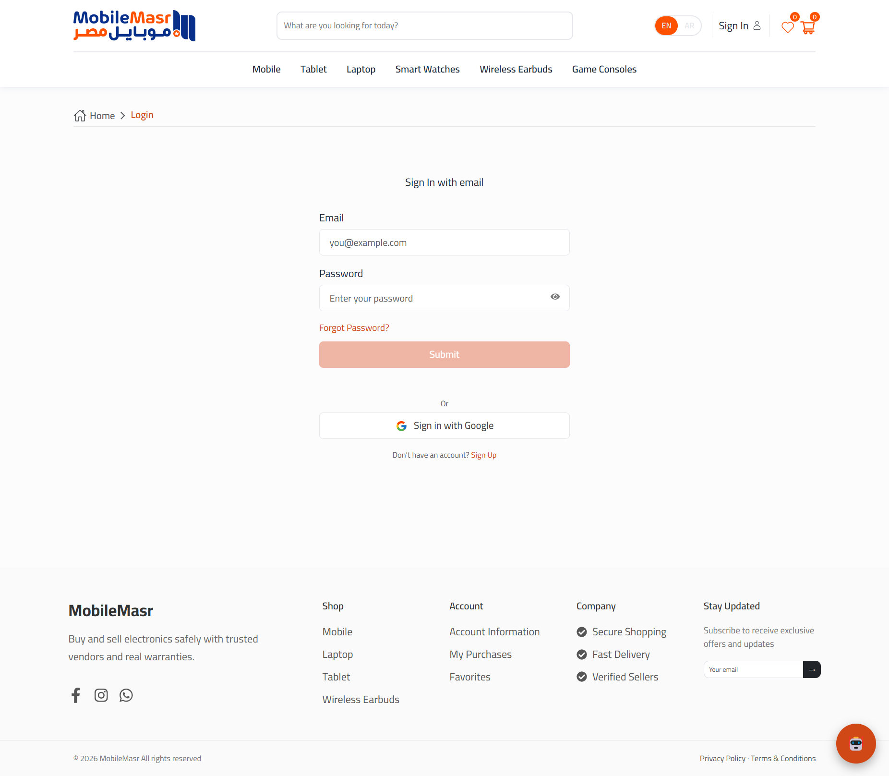</td>
    <td>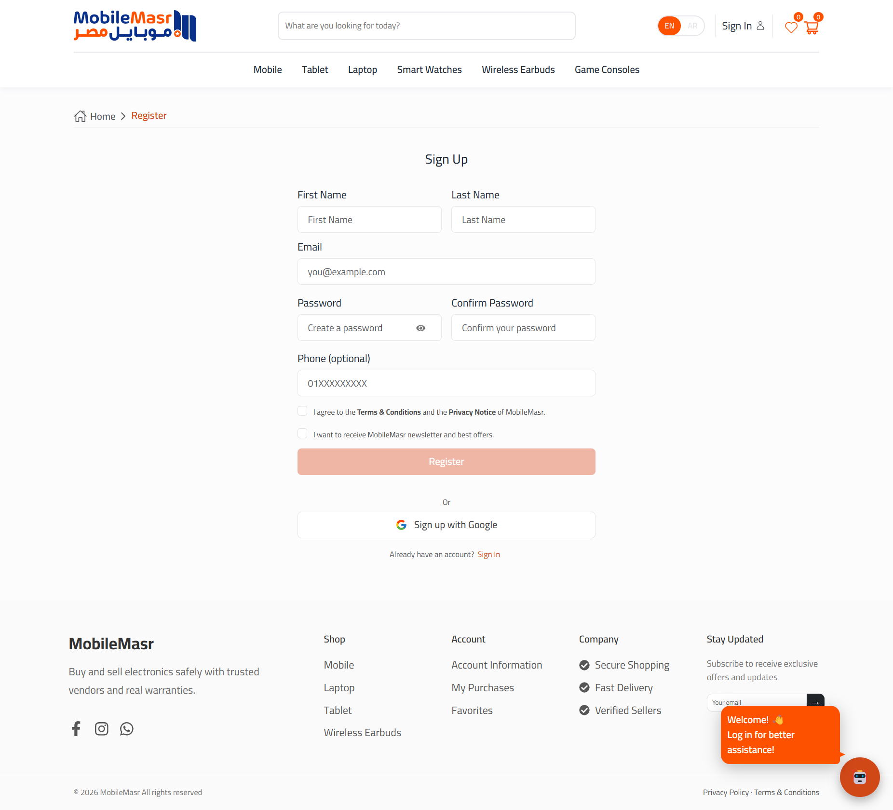</td>
  </tr>
  <tr>
    <td align="center"><strong>User Settings</strong></td>
    <td align="center"><strong>Welcome Screen</strong></td>
  </tr>
  <tr>
    <td>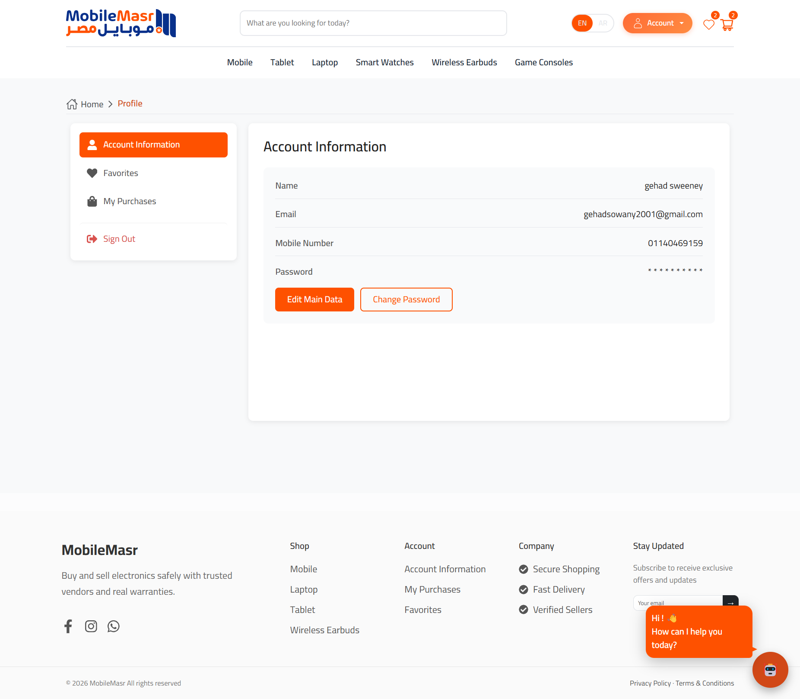</td>
    <td></td>
  </tr>
</table>

---

### 📱 Mobile Views

<table>
  <tr>
    <td align="center"><strong>Welcome</strong></td>
    <td align="center"><strong>Login</strong></td>
    <td align="center"><strong>Register</strong></td>
  </tr>
  <tr>
    <td></td>
    <td>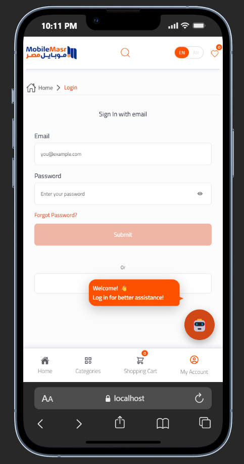</td>
    <td>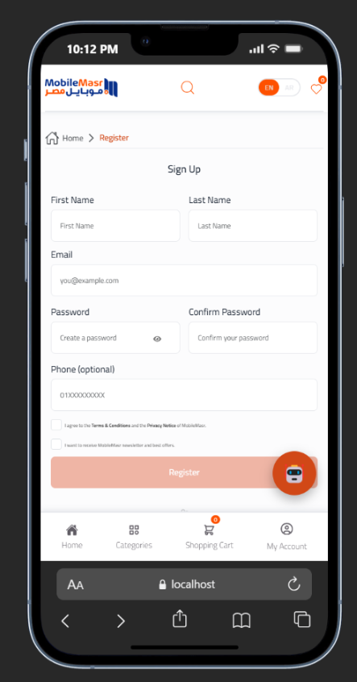</td>
  </tr>
  <tr>
    <td align="center"><strong>All Categories</strong></td>
    <td align="center"><strong>Cart</strong></td>
    <td align="center"><strong>AI Chat</strong></td>
  </tr>
  <tr>
    <td>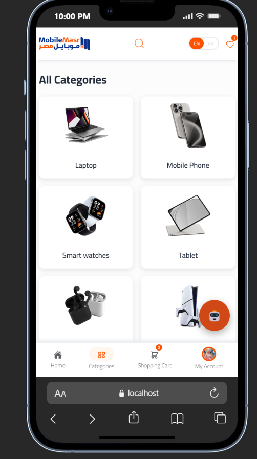</td>
    <td>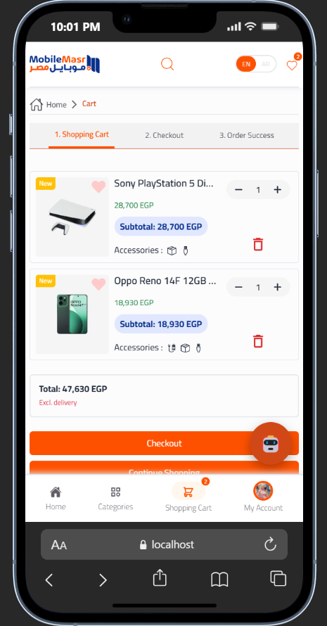</td>
    <td>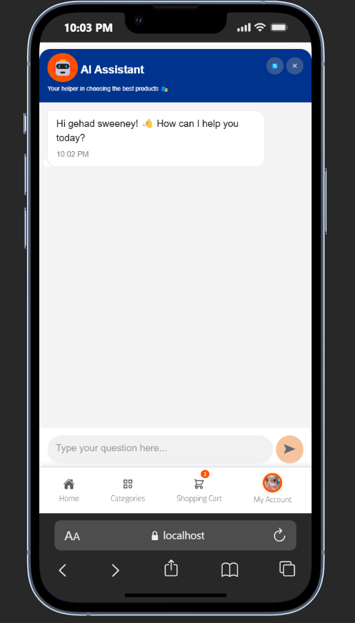</td>
  </tr>
  <tr>
    <td align="center"><strong>My Account</strong></td>
    <td align="center"></td>
    <td align="center"></td>
  </tr>
  <tr>
    <td>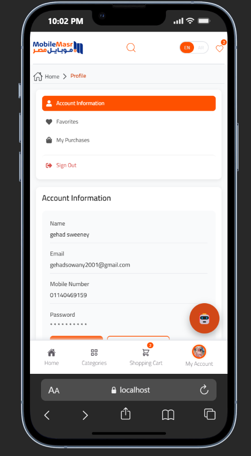</td>
    <td></td>
    <td></td>
  </tr>
</table>

---

## 🛠️ Tech Stack

| Category | Technology |
|----------|------------|
| Framework | React 19 |
| Build Tool | Vite 7 |
| Language | JavaScript (ESM) |
| State Management | Redux Toolkit 2 |
| Routing | React Router DOM 7 |
| UI | Bootstrap 5.3 + React Bootstrap |
| Forms | React Hook Form + Yup validation |
| Localization | i18next + react-i18next (AR / EN) |
| HTTP Client | Axios |
| AI — Chat & Search | Backend REST API (`/ai`) |
| AI — Comparison | OpenAI GPT-4o-mini (direct call) |
| Auth | JWT + Google OAuth (`@react-oauth/google`) |
| Notifications | React Toastify |
| Icons | React Icons |
| Carousel | Swiper 12 |

---

## 🧱 Project Structure

```
client/
├── src/
│   ├── Pages/
│   │   ├── Home/                  # Landing page, hero, featured products
│   │   ├── Auth/                  # Login and Register pages
│   │   ├── Category/              # Products filtered by category
│   │   ├── Categories/            # All categories overview
│   │   ├── ProductDetails/        # Single product view
│   │   ├── Comparison/            # Side-by-side comparison + AI
│   │   ├── Cart/                  # Cart, Checkout, Order Success
│   │   ├── Profile/               # User profile and sub-pages
│   │   ├── Vendor/                # Vendor profile page
│   │   ├── About/                 # About page
│   │   ├── Contact/               # Contact page
│   │   └── NotFoundPage/          # 404 page
│   ├── components/
│   │   ├── ChatFeature/           # Floating AI chat assistant
│   │   ├── ComparisonComponents/  # Comparison table + AI recommendation
│   │   ├── HomeComponents/        # Hero, sliders, featured sections
│   │   ├── NavbarComponents/      # Top navigation with AI search
│   │   ├── ProductDetailsComponents/
│   │   ├── CartComponents/
│   │   ├── CategoryComponents/
│   │   ├── LoginForm / RegisterForm/
│   │   ├── Footer/
│   │   └── Layout/
│   ├── context/
│   │   ├── AiContext.jsx          # AI chat state and session management
│   │   ├── CompareContext.jsx     # Product comparison state
│   │   └── IsLoginContext.jsx     # Authentication state
│   ├── store/
│   │   ├── store.js
│   │   └── slices/                # Products, Cart, Wishlist, User, Brands…
│   ├── services/
│   │   ├── aiApi.js               # AI chat backend service
│   │   ├── aiSearchService.js     # AI-powered search with GPT-4o-mini
│   │   └── api.js                 # General backend API client
│   ├── i18n.js                    # i18next configuration
│   └── routes.jsx                 # Application router
├── public/
├── screenshots/
└── package.json
```

---

## 🧭 Application Routes

### Public Routes

| Path | Description |
|------|-------------|
| `/` | Home page |
| `/categories` | All categories |
| `/category/:category` | Products by category |
| `/products/:id` | Product details |
| `/comparison` | Product comparison |
| `/vendor/:id` | Vendor profile |
| `/login` | Login page |
| `/register` | Register page |
| `/about` | About page |
| `/contact` | Contact page |

### Protected Routes (require login)

| Path | Description |
|------|-------------|
| `/profile` | Account info |
| `/profile/edit-account` | Edit profile |
| `/profile/change-password` | Change password |
| `/profile/favorites` | Wishlist |
| `/profile/orders` | Order history |
| `/profile/addresses` | Saved addresses |
| `/cart` | Shopping cart |
| `/cart/checkout` | Checkout |
| `/cart/order-success` | Order confirmation |

---

## ⚙️ Local Setup

### Prerequisites

- Node.js v18 or newer
- The Mobile Masr backend running (default: `localhost:3000`)
- An OpenAI API key for the AI comparison and search features

### 1. Install dependencies

```bash
npm install
```

### 2. Configure environment variables

Create a `.env` file in the `client/` root:

```env
VITE_API_URL=http://localhost:3000
VITE_OPENAI_API_KEY=your_openai_api_key
VITE_OPENAI_API_URL=https://api.openai.com/v1/chat/completions
```

### 3. Start the development server

```bash
npm run dev
```

Open your browser at: `http://localhost:5173`

### 4. Build for production

```bash
npm run build
```

### 5. Preview the production build

```bash
npm run preview
```

---

## 🔐 Authentication Flow

```
[User] → Login / Register → POST /auth/login
                                ↓
                     Token + user data saved to localStorage
                                ↓
               ProtectRoute checks localStorage token
                                ↓
          ✅ Logged in  →  Access granted to protected routes
          ❌ Guest      →  Redirect to /login
```

- Google OAuth is supported as an alternative login method
- On logout, localStorage is cleared and all AI chat sessions are wiped from sessionStorage

---

## 📚 Notes

- The AI Search feature uses OpenAI directly from the browser via `VITE_OPENAI_API_KEY`. Keep this key restricted to your domain in production.
- The AI Chat uses the backend as a proxy (`/ai`), so the key is not exposed for that feature.
- All AI features degrade gracefully — if the API is unavailable, fallback logic runs on the client side.
